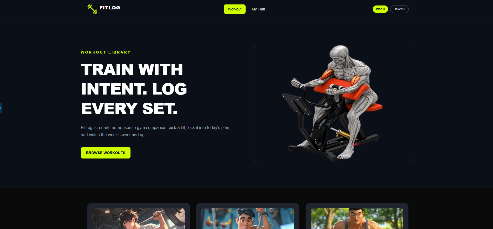
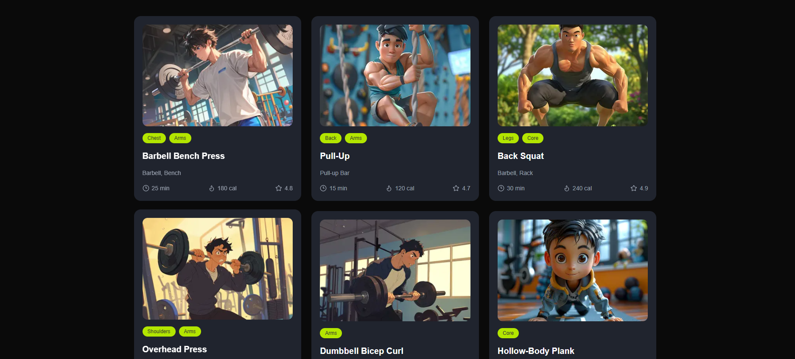
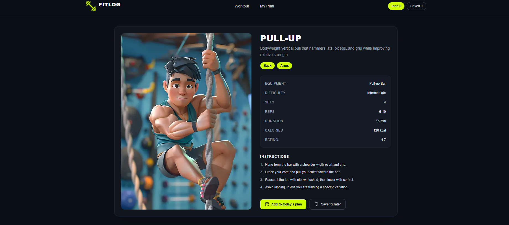
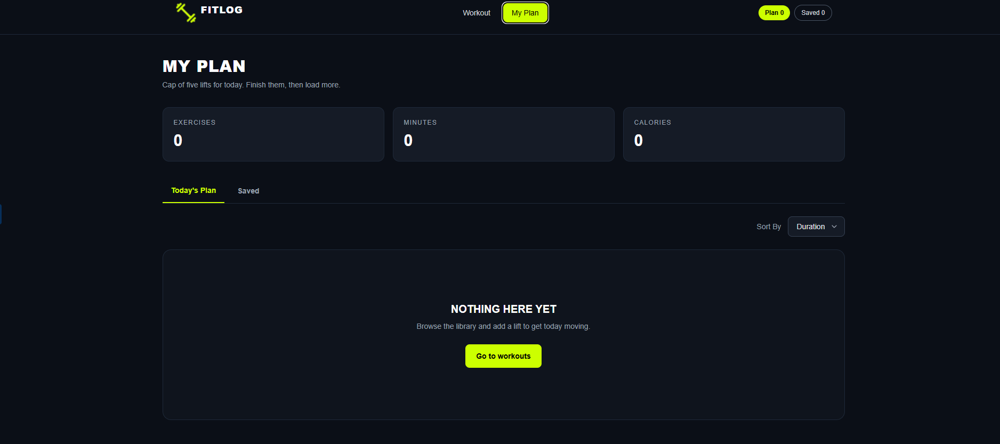

# FitLog

FitLog is a modern workout tracking and planning web application that helps users discover exercises, build a daily workout plan, and save workouts for later. It provides a clean and responsive interface for managing workouts efficiently.

## 🌐 Live Website

[**Visit FitLog →**](https://fitloog.netlify.app/)

## 📸 Project Screenshots

Click any screenshot to visit the live website.

  

  

  

  

## 🛠️ Technologies Used

- **Next.js** – React framework for building the application
- **React** – Building interactive UI components
- **JavaScript** – Application logic
- **Tailwind CSS** – Styling and responsive design
- **React Toastify** – Toast notifications
- **Lucide React** – Icons
- **Workout API** – Fetching workout and exercise data

## ✨ Key Features

### 1. Workout Library
Browse a collection of workouts with information such as muscle groups, difficulty, duration, calories, and ratings.

### 2. Daily Workout Plan
Add workouts to today's plan and keep track of the exercises you want to complete.

### 3. Save Workouts for Later
Save interesting workouts and access them later from the Saved section.

### 4. Workout Management
Mark workouts as completed or remove them from your plan with simple action buttons and toast notifications.

### 5. Responsive & Modern UI
A dark, modern fitness-focused interface that works across desktop, tablet, and mobile screen sizes.